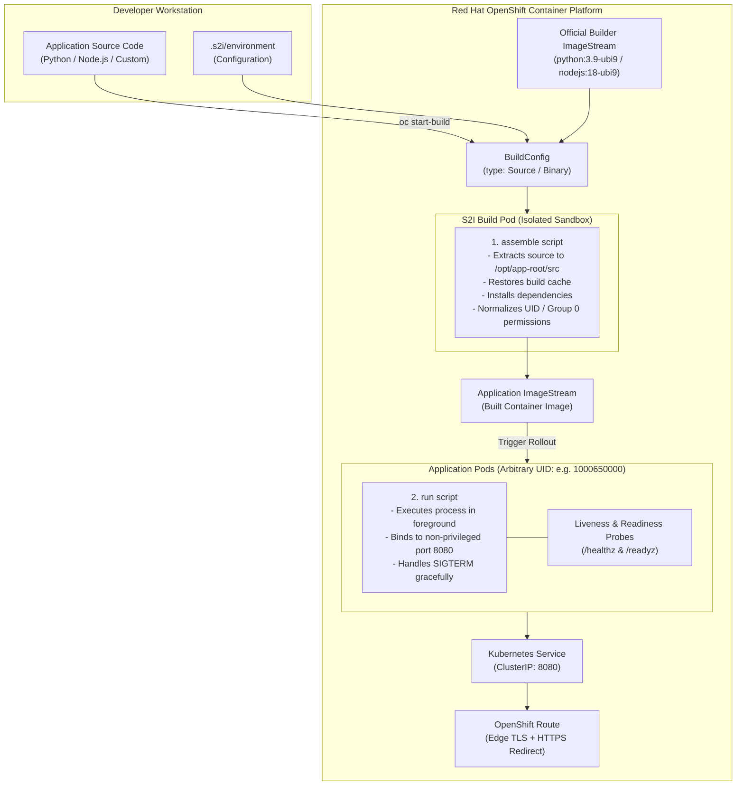

# Red Hat OpenShift Demos: Source-to-Image (S2I) & Enterprise Cloud-Native Suite

[](https://www.redhat.com/en/technologies/cloud-computing/openshift)
[-blue.svg)](https://github.com/openshift/source-to-image)
[](https://catalog.redhat.com/software/containers/explore)
[](docs/03-security-and-scc-guidelines.md)
[](scripts/verify-all.sh)

A complete, production-grade suite of **Red Hat OpenShift Demos**, centered around **Source-to-Image (S2I)**, official Red Hat Universal Base Image (UBI 9) builders, declarative Kubernetes/OpenShift manifests, inner-loop binary builds, and cloud-native CI/CD pipelines.

Designed strictly following **official Red Hat documentation and OpenShift 4.x best practices** so every demo deploys smoothly without the typical pitfalls (UID permissions, probe failures, route misconfigurations, or broken API groups).

---

## 1. High-Level Architecture & S2I Workflow

Source-to-Image (S2I) separates application code from container operational management:



---

## 2. Demos Catalog

| Demo Directory | Technology / Pattern | Key Features | Documentation |
| :--- | :--- | :--- | :--- |
| **[`01-s2i-python-app/`](01-s2i-python-app/)** | Python 3.9+ / Gunicorn / UBI 9 | Dual standalone/WSGI execution, health probes, arbitrary UID compliance, `.s2i/environment`. | [README](01-s2i-python-app/README.md) |
| **[`02-s2i-nodejs-app/`](02-s2i-nodejs-app/)** | Node.js 18+ / Express-style / UBI 9 | Native JSON REST endpoints, `/healthz` & `/readyz` probes, graceful `SIGTERM` handler. | [README](02-s2i-nodejs-app/README.md) |
| **[`03-custom-s2i-builder/`](03-custom-s2i-builder/)** | Custom S2I Builder from Scratch | Deep dive into S2I internals: custom `assemble`, `run`, `save-artifacts`, and `usage` scripts on UBI 9 Minimal. | [README](03-custom-s2i-builder/README.md) |
| **[`04-binary-build-workflow/`](04-binary-build-workflow/)** | Inner-Loop Rapid Iteration | `oc start-build --from-dir=.` workflow for testing code changes in seconds without git commits. | [README](04-binary-build-workflow/README.md) |
| **[`05-complete-production-stack/`](05-complete-production-stack/)** | Full Enterprise Production Spec | ConfigMaps, Secrets, Probes, Resource Quotas, HPA (autoscaling 2-5 pods), NetworkPolicies, Kustomize. | [README](05-complete-production-stack/README.md) |
| **[`06-openshift-pipelines-tekton/`](06-openshift-pipelines-tekton/)** | Tekton Cloud-Native CI/CD | OpenShift Pipelines with official `git-clone`, `s2i-python`, and `openshift-client` ClusterTasks. | [README](06-openshift-pipelines-tekton/README.md) |

---

## 3. Quick Start: Local Verification & Pre-Flight Check

You can verify all manifests, run the unit test suites, and execute the **local S2I Contract Simulation** right in your terminal without requiring Docker, Podman, or an active OpenShift cluster:

```bash
# Run the all-in-one pre-flight test suite:
bash scripts/verify-all.sh
```

### What `verify-all.sh` executes:
1. **Manifest Validation:** Validates YAML syntax and verifies official OpenShift 4.x API groups (`build.openshift.io/v1`, `image.openshift.io/v1`, `route.openshift.io/v1`, etc.).
2. **Unit Tests:** Executes zero-dependency test suites for Python and Node.js.
3. **S2I Contract Simulation:** Emulates the exact S2I build container lifecycle (`assemble` -> permission normalization -> `run` -> HTTP probe verification on `/`, `/healthz`, `/readyz` -> graceful `SIGTERM` shutdown).

---

## 4. Deploying to an OpenShift Cluster

### Option A: Automated One-Click Deployment
If logged into an active OpenShift cluster (`oc whoami`):

```bash
# Deploys all demos to project 'openshift-demos'
bash scripts/deploy-all.sh openshift-demos
```

### Option B: Deploying an Individual Demo
Navigate into any demo directory and follow its README. For example:

```bash
oc new-project openshift-demos || oc project openshift-demos

# 1. Apply declarative manifests
oc apply -f 01-s2i-python-app/k8s/

# 2. Upload source code to trigger S2I build
oc start-build s2i-python-demo --from-dir=01-s2i-python-app --follow

# 3. Check deployment and retrieve Route URL
oc rollout status deployment/s2i-python-demo
ROUTE=$(oc get route s2i-python-demo -o jsonpath='{.spec.host}')
curl -k "https://${ROUTE}/"
```

---

## 5. Why These Demos Do Not Fail: Official Red Hat Rules

Many OpenShift tutorials fail in real production clusters because they ignore OpenShift's default security model (**`restricted-v2` SCC**). These demos strictly enforce:

1. **Arbitrary Assigned UIDs:**
   - In OpenShift, containers **never run as root (UID 0)**. OpenShift allocates an arbitrary random UID per project (e.g., `1000650000`).
   - All files in our builder images and S2I scripts are owned by **Group `0` (root group)** with `chmod -R g=u` permissions.
2. **Non-Privileged Ports:**
   - Linux prevents non-root users from binding to ports `< 1024`.
   - All demos listen on port **`8080`** (or `8443` for TLS).
3. **Explicit Health Probes:**
   - Every demo provides real HTTP `/healthz` and `/readyz` endpoints with calibrated `initialDelaySeconds` and timeouts.
4. **Official OpenShift API Groups:**
   - All manifests use modern OpenShift 4.x APIs (`apps/v1`, `build.openshift.io/v1`, `image.openshift.io/v1`, `route.openshift.io/v1`).
5. **Secure Edge TLS Routes:**
   - All Routes include `tls.termination: edge` and `insecureEdgeTerminationPolicy: Redirect` for production HTTPS.

---

## 6. Deep Dive Documentation Guides

For in-depth explanations and operational guides, see the [`docs/`](docs/) directory:

- [**01. S2I Architecture & Lifecycle Guide**](docs/01-s2i-architecture-and-lifecycle.md): Detailed breakdown of `assemble`, `run`, `save-artifacts`, and builder vs. runtime images.
- [**02. OpenShift Core Primitives**](docs/02-openshift-core-primitives.md): Deep dive into `BuildConfig`, `ImageStream`, `Route`, `Deployment`, `ConfigMap`, and `Secret`.
- [**03. Security & SCC Guidelines**](docs/03-security-and-scc-guidelines.md): How OpenShift's `restricted-v2` SCC works, arbitrary UIDs, and Group 0 permissions.
- [**04. Cluster Deployment Runbook**](docs/04-cluster-deployment-runbook.md): Production deployment steps for ROSA, ARO, OpenShift Local (CRC), and Bare Metal.
- [**05. Troubleshooting Matrix**](docs/05-troubleshooting-matrix.md): Solutions for `CrashLoopBackOff`, `ErrImagePull`, UID permission errors, and 503 Route errors.

---

## 7. OpenShift CLI (`oc`) Essential Cheat Sheet

```bash
# --- Projects & Context ---
oc whoami                                       # Current user
oc project <name>                               # Switch project
oc new-project <name>                           # Create project

# --- Builds & S2I ---
oc get bc                                       # List BuildConfigs
oc get builds                                   # List build instances
oc start-build <bc-name> --follow               # Trigger build & stream logs
oc start-build <bc-name> --from-dir=. --follow  # Binary build from local folder
oc logs -f bc/<bc-name>                         # Follow build logs

# --- Applications & Pods ---
oc get pods -w                                  # Watch pods
oc get deployment                               # List deployments
oc rollout status deployment/<name>             # Monitor rollout
oc rollout restart deployment/<name>            # Trigger redeployment
oc logs deployment/<name> --tail=50             # Tail app logs

# --- Networking & Routes ---
oc get services                                 # List services
oc get routes                                   # List routes & public hostnames
oc create route edge <name> --service=<svc>     # Create Edge TLS route
```

---

## 8. Teardown

To clean up all resources created in your OpenShift cluster:

```bash
bash scripts/cleanup-all.sh openshift-demos
```
